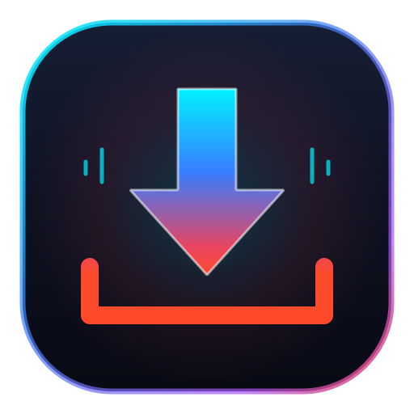

# ⚡ FlexDown - Advanced High-Speed Download Manager

<div align="center">



**مدير تنزيل متطور وفائق السرعة لسطح المكتب بديل عصري وقوي لـ IDM**  
*Modern, High-Speed IDM Alternative with PyQt6, yt-dlp, and 16-Segment Turbo Acceleration.*

[](https://www.python.org/)
[](https://pypi.org/project/PyQt6/)
[](LICENSE)
[](https://www.microsoft.com/)

</div>

---

## 🌟 المميزات الرئيسية (Key Features)

- **⚡ محرك تسريع توربو فائق (Turbo 16-Segment Accelerator):** تجزئة الملفات إلى 16 مسار اتصال متزامن لتحقيق أقصى سرعة ممكنة لخط الإنترنت.
- **🎬 دعم شامل لكافة منصات الوسائط:** تنزيل الفيديوهات والصوتيات من YouTube، TikTok، Facebook، Instagram، SoundCloud ومئات المواقع عبر `yt-dlp`.
- **🎯 اختيار دقيق للجودة والصيغ:** بطاقة بارزة لاختيار الدقة من 144p حتى 4K و 8K، مع استخراج الصوت بنقاء عالٍ (MP3 320 kbps).
- **🌐 إضافة متصفح ذكية (Browser Extension):** التقاط الروابط بنقرة واحدة من متصفحي Google Chrome و Microsoft Edge.
- **⏸️ تحكم كامل وسهل:** إيقاف مؤقت (Pause)، استئناف (Resume)، وإلغاء (Cancel) التنزيلات بنقرة واحدة مع استئناف ذكي من مكان التوقف.
- **🔒 أمان وخصوصية فائقة:** تشفير الملفات بعد التنزيل بكلمة سر عبر خوارزمية AES-256، مع وضع تنظيف أثر الملفات المؤقتة.
- **🔄 محول صيغ وسائط مدمج:** تحويل صيغ الفيديو والصوتيات فوراً (MP4, MKV, AVI, MP3, WAV, FLAC).
- **📅 جدولة التنزيلات:** تحديد أوقات تنزيل الملفات لاحقاً في أوقات محددة تلقائياً.
- **🎨 واجهة عصرية مزدوجة:** دعم كامل للغة العربية (RTL) والإنجليزية، مع إمكانية التبديل الفوري بين الوضع الليلي والنهاري (Dark / Light Mode).

---

## 🚀 البدء والتشغيل (Getting Started)

### 1. المتطلبات الأساسية (Prerequisites)
- نظام تشغيل Windows 10 أو 11
- بيئة Python 3.10 أو أحدث

### 2. التثبيت (Installation)

```bash
# استنساخ المستودع
git clone https://github.com/Abbderahmenblk31/FlexDown.git
cd FlexDown

# تثبيت الحزم المطلوبة
pip install -r requirements.txt
```

### 3. تشغيل البرنامج (Run)

```bash
python main.py
```

### 4. بناء ملف تنفيذي مستقل (Build Portable EXE)

```bash
pyinstaller FlexDown.spec --noconfirm
```
سيكون الملف التنفيذي متاحاً داخل مجلد `dist/FlexDown/FlexDown.exe`.

---

## 🧩 بنية المشروع (Project Structure)

```
FlexDown/
├── flexdown/
│   ├── core/              # محركات التنزيل (Turbo, HTTP, yt-dlp, Queue)
│   ├── models/            # نماذج عناصر وحالات التنزيل
│   ├── ui/                # نوافذ PyQt6 والواجهات الرسومية
│   ├── security/          # التشفير وإدارة الخصوصية والبروكسي
│   ├── themes/            # ملفات الأنماط QSS (Light / Dark)
│   ├── i18n/              # ملفات الترجمة العربية والإنجليزية
│   └── utils/             # دوال معالجة الملفات والروابط والإعدادات
├── browser_extension/     # إضافة المتصفح لـ Chrome و Edge
├── resources/             # الأيقونات والخطوط والشعار
├── tests/                 # اختبارات الجودة الأوتوماتيكية Pytest
├── main.py                # نقطة الانطلاق الرئيسية للتطبيق
└── FlexDown.spec          # إعدادات حزم PyInstaller
```

---

## 📄 الترخيص (License)
هذا المشروع مرخص تحت رخصة **MIT**.
